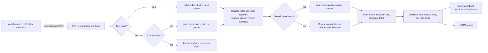

# Invoice Data Extractor

Pull structured data out of invoice PDFs (number, dates, vendor, line items, subtotal, tax and total), check that the numbers add up, and export the results to a formatted Excel workbook and to JSON.

> **Note:** This is a demo/learning project. Every vendor, customer, product and invoice in `samples/` is fictional and was generated by `scripts/generate_samples.py`.

## Features

- **Multi-layout extraction** with [pdfplumber](https://github.com/jsvine/pdfplumber):
  - ruled tables are detected and their columns mapped by header name (`Qty`, `Rate`, `Line Total`, ...)
  - borderless layouts fall back to regex parsing of the rows between the column header and `Subtotal`
  - handles quantity-first and quantity-last column orders
- **Locale-aware parsing** of US (`$1,234.56`), UK (`£1,234.56`) and European (`1.234,56 €`) money formats, plus several date formats (`2026-03-14`, `14.03.2026`, `March 14, 2026`, `14 Mar 2026`)
- **Validation:** checks required fields, `qty × unit price = amount` on every line, that the line items add up to the subtotal, that subtotal + tax + shipping equals the total, and that the tax amount matches the stated rate (the last one only raises a warning)
- **Exports:**
  - an **Excel** workbook with an *Invoices* summary sheet and a *Line Items* sheet, styled headers, frozen panes, auto-filters, number and date formats, and invalid rows highlighted in red
  - a **JSON** file with a summary block and every invoice
- **Watch-folder mode:** polls an inbox folder and processes new or changed PDFs once they've finished copying, then rebuilds the combined reports
- **Optional OCR path** for scanned (image-only) invoices with pytesseract. It isn't needed for the samples and is never imported unless you turn it on.
- Configured through `config.yaml`, which `.env` and environment variables can override. Uses the standard `logging` module and has type hints throughout.
- **85 pytest tests** check the extracted values against a ground-truth manifest for every sample PDF.

## Tech stack

| Purpose | Library |
| --- | --- |
| PDF text and table extraction | pdfplumber (pdfminer.six) |
| Sample PDF generation | reportlab |
| Excel export | openpyxl |
| Configuration | PyYAML, python-dotenv |
| Tests | pytest |
| Optional OCR | pytesseract + Tesseract |

Requires Python 3.11 or later; developed and tested on 3.12.

## Project structure

```
invoice-data-extractor/
├── config.yaml                 # default settings (paths, tolerance, watch, OCR)
├── .env.example                # environment overrides
├── pyproject.toml              # package metadata + pytest config
├── requirements.txt
├── samples/                    # 10 generated invoice PDFs + expected.json ground truth
├── scripts/
│   └── generate_samples.py     # deterministic reportlab generator (fixed seed)
├── src/invoice_extractor/
│   ├── __main__.py             # `python -m invoice_extractor`
│   ├── cli.py                  # argparse CLI: extract / watch
│   ├── config.py               # Settings dataclass, YAML + env loading
│   ├── extractor.py            # pdfplumber reading, field/table/line-item parsing
│   ├── parsing.py              # money, quantity, date & currency helpers
│   ├── validator.py            # arithmetic + completeness checks
│   ├── exporters.py            # Excel (openpyxl) and JSON writers
│   ├── pipeline.py             # batch processing helpers
│   ├── watcher.py              # polling watch-folder mode
│   ├── ocr.py                  # optional pytesseract fallback
│   └── models.py               # Invoice / LineItem / ValidationResult
└── tests/                      # pytest suite (runs against samples/)
```

## Setup

```bash
python -m venv .venv
# Windows: .venv\Scripts\activate    macOS/Linux: source .venv/bin/activate
pip install -r requirements.txt
cp .env.example .env                # optional
```

`pyproject.toml` makes the package installable (`pip install -e .`), which also gives you an `invoice-extractor` console command. Without installing it, put `src` on `PYTHONPATH` as the examples below do.

## Usage

```bash
# Extract every PDF in samples/ -> output/invoices.xlsx + output/invoices.json
PYTHONPATH=src python -m invoice_extractor extract samples --out output

# Single file, JSON only; --strict exits with code 2 if any invoice fails validation
PYTHONPATH=src python -m invoice_extractor extract samples/invoice_03_bluepeak.pdf --format json --strict

# Watch a folder: drop PDFs into ./inbox and the reports in ./output are rebuilt
PYTHONPATH=src python -m invoice_extractor watch --input inbox --out output --interval 3
```

On Windows PowerShell, set the path first with `$env:PYTHONPATH="src"`.

Example output:

```
Processed 10 invoice(s): 9 valid, 1 invalid, 0 failed to parse.
  [OK ] invoice_01_northwind.pdf         NW-2026-4183   Northwind Office Supplies      935.64 USD
  [OK ] invoice_05_alderfinch.pdf        AF/7634        Alder & Finch Design Studio    5274.00 GBP
  [OK ] invoice_07_kestrel.pdf           KL-00636       Kestrel Logistik GmbH          4645.05 EUR
  [BAD] invoice_10_copperleaf.pdf        CC-8658        Copperleaf Catering Co.        1547.34 USD
  ...
```

### Regenerating the samples

```bash
python scripts/generate_samples.py          # rewrites samples/*.pdf and samples/expected.json
```

The generator uses a fixed seed and reportlab's `invariant` mode, so it produces the same files every time.

### Running tests

```bash
pytest
```

## Sample data

`samples/` holds 10 single-page invoices (about 2.5 KB each) from five fictional vendors, in three layouts:

| Vendor | Layout | Currency / number format | Date format | Notes |
| --- | --- | --- | --- | --- |
| Northwind Office Supplies | ruled table | USD `$1,234.56` | `2026-07-26` | has a shipping line |
| Bluepeak Cloud Services | borderless, coloured header | USD | `January 27, 2026` | usage-based quantities |
| Alder & Finch Design Studio | compact, qty-first columns, `From:` label | GBP `£1,234.56` | `08 Jan 2026` | VAT 20% |
| Kestrel Logistik GmbH | ruled table | EUR `1.234,56 €` | `30.05.2026` | VAT 19% |
| Copperleaf Catering Co. | borderless, coloured header | USD | `June 14, 2026` | `invoice_10` has a **deliberately wrong total** (+10.00) |

`samples/expected.json` stores the true values for every invoice. The tests compare each extracted field against it.

## How it works



## Optional: OCR for scanned invoices

A scanned invoice is an image with no text layer, so pdfplumber finds no text. By default the extractor stops with a clear `ExtractionError`. To read scans instead:

1. Install the [Tesseract](https://github.com/tesseract-ocr/tesseract) binary and make sure it is on your `PATH`.
2. Run `pip install pytesseract` (or `pip install -e .[ocr]`).
3. Set `ocr.enabled: true` in `config.yaml`, or `INVOICE_OCR_ENABLED=true` in `.env`.

Pages are rendered at 300 DPI with pdfplumber's built-in renderer (pypdfium2), so you don't need poppler or pdf2image. The OCR text then goes through the same parsing and validation as a normal PDF. Expect lower accuracy: OCR can misread characters such as `,` and `.`, and the validator is what catches those errors.

## Future improvements

- Per-vendor templates (YAML regex overrides) for layouts the general rules can't parse
- Line items that run across several lines or pages
- Bounding-box parsing (`page.extract_words`) so columns are found by x-position instead of text order
- Duplicate invoice detection (same vendor and invoice number)
- Optional LLM or layout-model fallback for low-confidence fields, with a confidence score per field
- CSV export and a small web UI for reviewing invalid invoices
- An event-based watcher (watchdog) as an alternative to polling on local disks
